# Laporan Praktikum 4: CSS Layout

| | |
|---|---|
| **Nama** | Najla Wening Khairunnisa |
| **NIM** | 312510225 |
| **Kelas** | l253B |
| **Mata Kuliah** | Pemrograman Web |
| **Dosen** | Sufajar Butsianto |

## Tujuan Praktikum

1. Memahami struktur dasar pembuatan layout web.
2. Memahami konsep box element.
3. Memahami CSS float.
4. Memahami elemen semantik HTML5.
5. Membuat layout web sederhana.

## Struktur Folder

```
Lab4Web/
├── lab4_box.html
├── lab4_layout/
│   ├── home.html
│   ├── style.css
│   ├── about.html
│   └── kontak.html
├── screenshots/
└── README.md
```

File `lab4_box.html` dipakai untuk latihan box element, float, dan clearfix. Folder `lab4_layout` dipakai untuk latihan layout web sederhana beserta tugas halaman About dan Kontak.

---

## Bagian 1. Box Element dan CSS Float

### Langkah yang dilakukan

Pertama dibuat file `lab4_box.html` dengan kerangka HTML dan sebuah `<header>` berisi judul "Box Element". Di dalam `<section>` ditambahkan tiga elemen `div` dengan class `div1`, `div2`, dan `div3`.

Tanpa CSS tambahan, ketiga `div` tampil bertumpuk ke bawah karena `div` adalah elemen block yang selalu memakai satu baris penuh. Untuk membuatnya berjajar ke samping, ditambahkan CSS pada tag `<style>`:

```css
div {
    float: left;
    padding: 10px;
}
.div1 { background: red; }
.div2 { background: yellow; }
.div3 { background: green; }
```

Properti `float: left` membuat setiap `div` bergeser ke sisi kiri dan elemen berikutnya menempel di sebelahnya. Properti `padding: 10px` memberi ruang antara teks dengan tepi kotak. Setiap `div` diberi warna latar yang berbeda supaya batas masing-masing kotak terlihat jelas.

### Hasil

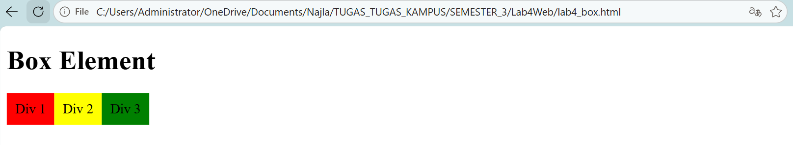

Div 1 (merah), Div 2 (kuning), dan Div 3 (hijau) tampil berjajar dari kiri ke kanan.

---

## Bagian 2. Clearfix

### Langkah yang dilakukan

Setelah `div3` ditambahkan satu elemen lagi, yaitu `div4`. Elemen ini diberi CSS berikut:

```css
.div4 {
    background-color: blue;
    clear: left;
    float: none;
}
```

Properti `clear` dipakai untuk mengatur posisi elemen yang berada setelah elemen float. Properti `float: none` diperlukan karena aturan `div { float: left; }` juga berlaku untuk `div4`, sehingga harus dibatalkan khusus untuk elemen ini.

Percobaan dilakukan dengan tiga nilai `clear`.

**Percobaan 1: `clear: left`**

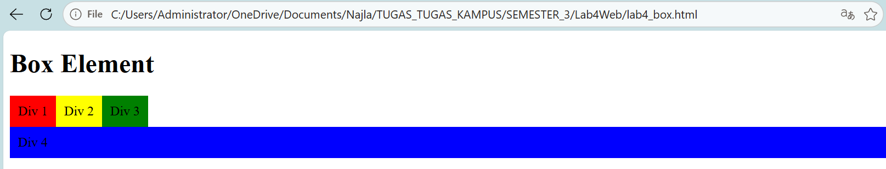

Div 4 (biru) turun ke bawah dan menempati satu baris penuh di bawah Div 1 sampai Div 3. Hal ini terjadi karena ketiga elemen sebelumnya mengambang ke kiri, sehingga `clear: left` memaksa Div 4 berada di bawahnya.

**Percobaan 2: `clear: right`**

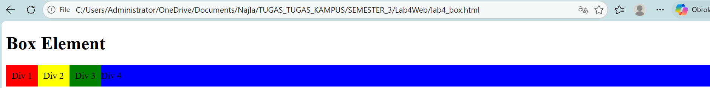

Div 4 tidak turun ke bawah. Kotak biru tetap berada pada baris yang sama dengan Div 1 sampai Div 3, dan tulisan "Div 4" tergeser ke kanan Div 3. Pada percobaan ini tidak ada elemen yang mengambang ke kanan, sehingga `clear: right` tidak berpengaruh terhadap posisi Div 4.

**Percobaan 3: `clear: both`**

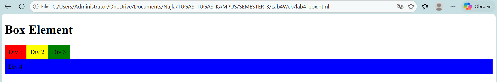

Hasilnya sama dengan `clear: left`, yaitu Div 4 turun ke bawah. Nilai `both` menghindari elemen float di kedua sisi, sehingga cocok dipakai ketika arah float tidak diketahui atau berbeda-beda.

### Kesimpulan percobaan

| Nilai `clear` | Posisi Div 4 |
|---|---|
| `left` | Turun ke bawah Div 1-3 |
| `right` | Tetap sejajar, tidak turun |
| `both` | Turun ke bawah Div 1-3 |

Untuk kode akhir, nilai yang dipakai adalah `clear: left`.

---

## Bagian 3. Membuat Layout Web Sederhana

Layout dibuat pada folder `lab4_layout` dengan dua file utama, yaitu `home.html` untuk struktur halaman dan `style.css` untuk tampilan.

### 3.1 Kerangka Layout

Struktur halaman dibuat menggunakan elemen semantik HTML5 di dalam `<div id="container">`:

| Elemen | Fungsi |
|---|---|
| `<header>` | Bagian judul situs |
| `<nav>` | Menu navigasi (Home, Artikel, About, Kontak) |
| `<section id="hero">` | Panel utama di bagian atas |
| `<section id="wrapper">` | Pembungkus konten utama dan sidebar |
| `<section id="main">` | Konten utama |
| `<aside id="sidebar">` | Kolom samping |
| `<footer>` | Bagian bawah halaman |

Pada tahap ini `style.css` masih kosong, sehingga halaman tampil polos dengan gaya bawaan browser.

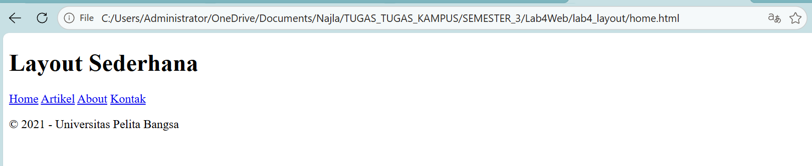

### 3.2 Header

CSS mulai ditulis pada `style.css`. Isinya meliputi import font Open Sans dari Google Fonts, reset CSS dengan `* { margin: 0; padding: 0; }` agar jarak bawaan browser hilang, serta pengaturan `body`. Elemen `#container` diberi lebar 980px dan `margin: 0 auto` agar berada di tengah halaman, ditambah `box-shadow` sebagai bayangan tipis. Judul pada header diberi warna abu-abu muda.

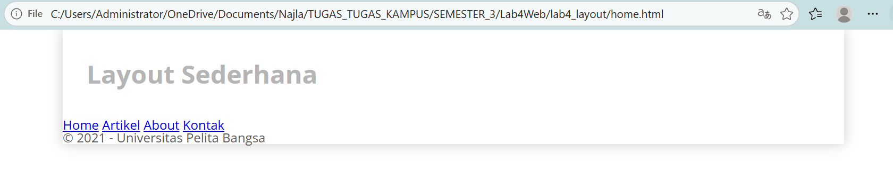

### 3.3 Navigasi

Menu navigasi diberi latar biru (`#1f5faa`). Setiap link diubah menjadi `display: inline-block` supaya berjajar ke samping namun tetap bisa diberi padding. Garis bawah pada link dihilangkan dengan `text-decoration: none`. Link yang aktif atau sedang di-hover berubah menjadi biru yang lebih terang.

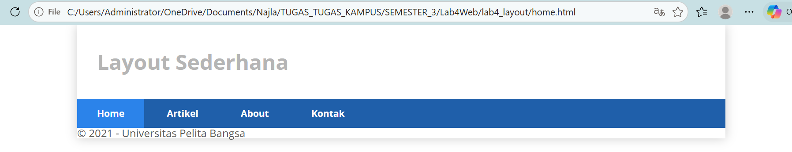

### 3.4 Hero Panel

Pada `<section id="hero">` ditambahkan judul "Hello World!", satu paragraf, dan tombol "Learn more". Panel diberi latar abu-abu (`#e4e4e5`) dengan padding `50px 20px` agar isinya tidak menempel ke tepi. Ukuran judul diatur 35px dan paragraf 18px dengan jarak antarbaris 25px.

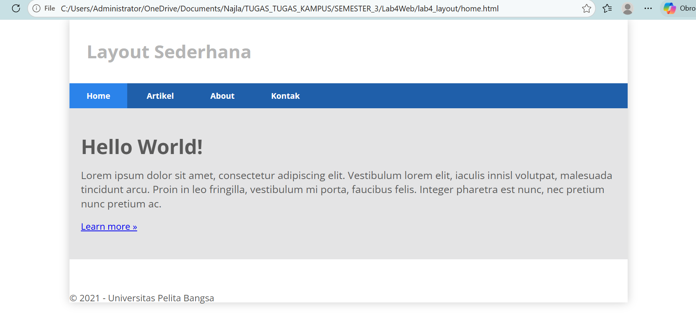

### 3.5 Main Content, Sidebar, dan Widget

Kolom utama dan sidebar disusun berdampingan menggunakan float:

```css
#main    { float: left; width: 640px; padding: 20px; }
#sidebar { float: left; width: 260px; padding: 20px; }
```

Jika dihitung bersama padding, lebar `#main` adalah 680px dan `#sidebar` adalah 300px, sehingga totalnya 980px dan pas dengan lebar container.

Selanjutnya sidebar diisi dua widget. Widget pertama berisi daftar link dan widget kedua berisi teks. Judul widget (`.title`) diberi latar biru dan teks putih, sedangkan daftar link dibuat tanpa bullet, diberi garis pemisah, dan berubah warna saat di-hover.

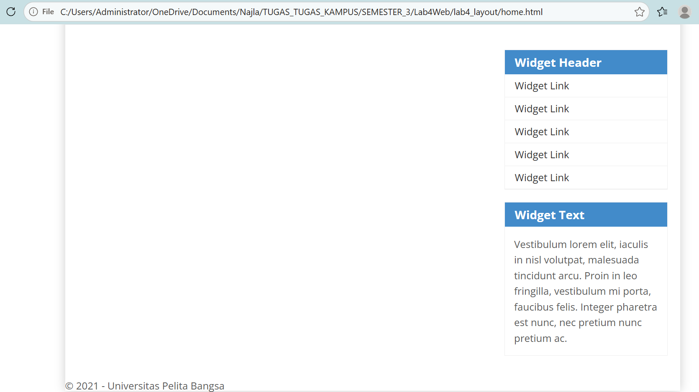

### 3.6 Footer

Footer diberi latar hitam (`#1d1d1d`) dan teks terang. Properti `clear: both` diperlukan karena `#main` dan `#sidebar` sama-sama float. Tanpa properti ini, footer akan naik dan tertimpa oleh kedua kolom tersebut.

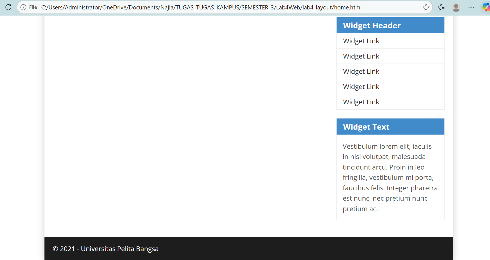

### 3.7 Konten Box

Pada `#main` ditambahkan satu baris (`.row`) berisi tiga `.box`. Setiap box memuat gambar bulat, judul, deskripsi singkat, dan tombol "View detail".

Tiap box diberi `float: left` dan `width: 33.333333%` sehingga terbagi tiga sama lebar. Properti `box-sizing: border-box` dipakai agar padding tidak menambah lebar box. Gambar dibuat bulat dengan `border-radius: 50%`.

Karena seluruh isi `.row` adalah elemen float, tinggi `.row` menjadi nol. Masalah ini diatasi dengan teknik clearfix pada pseudo-element `:after`:

```css
.row:after { content: ''; display: table; clear: both; }
```

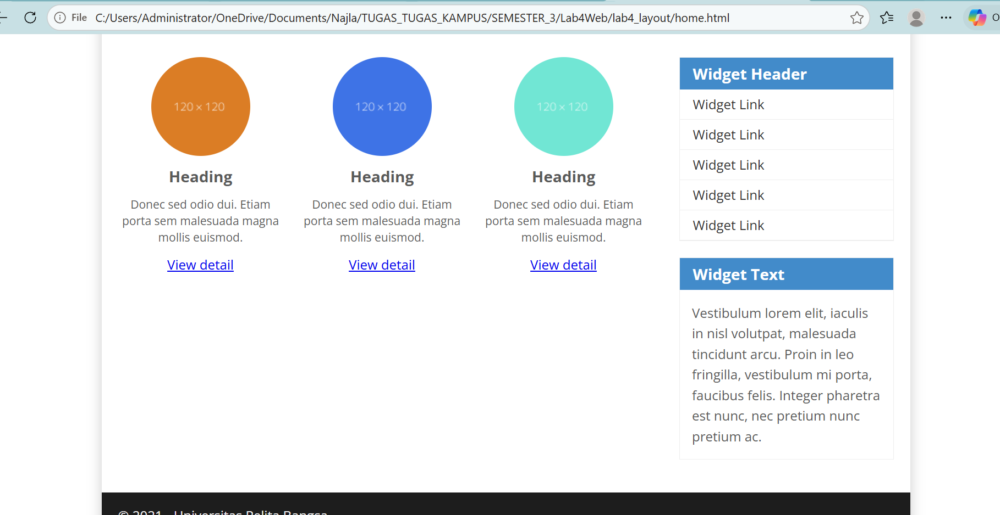

### 3.8 Konten Artikel

Di bawah baris box ditambahkan dua `<article class="entry">` yang dipisahkan garis `<hr class="divider">`. Pada artikel pertama gambar berada di kiri teks dengan `float: left`. Pada artikel kedua gambar diberi class `right-img` sehingga berada di kanan teks dengan `float: right`.

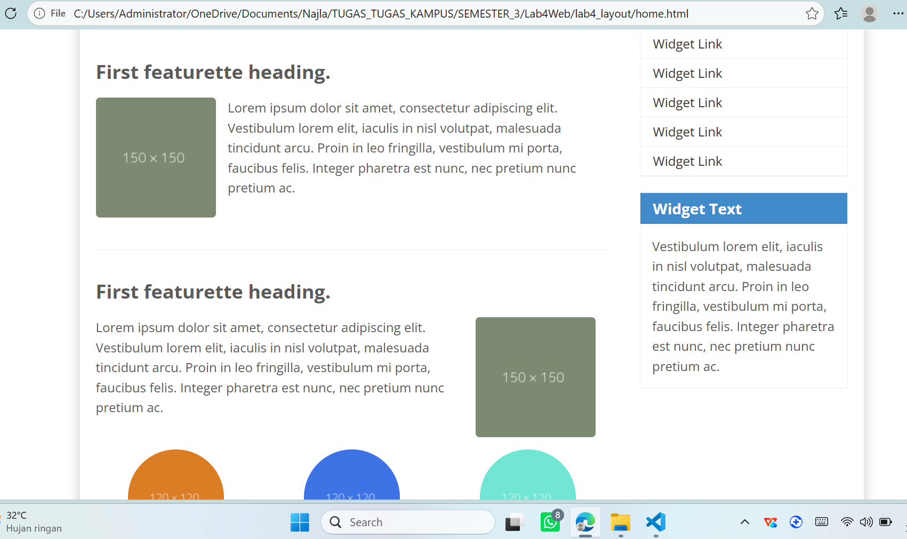

---

## Bagian 4. Tugas

### Tugas 1: Halaman About

File `about.html` dibuat dengan layout single, yaitu tanpa sidebar sehingga konten memakai seluruh lebar container. Untuk itu `#main` diberi class tambahan `full` dengan `float: none` dan `width: 940px`. Isi halaman terdiri dari deskripsi singkat tentang diri sendiri beserta daftar keahlian, lalu bagian portfolio berisi tiga proyek yang memakai komponen `.box` dari latihan sebelumnya.

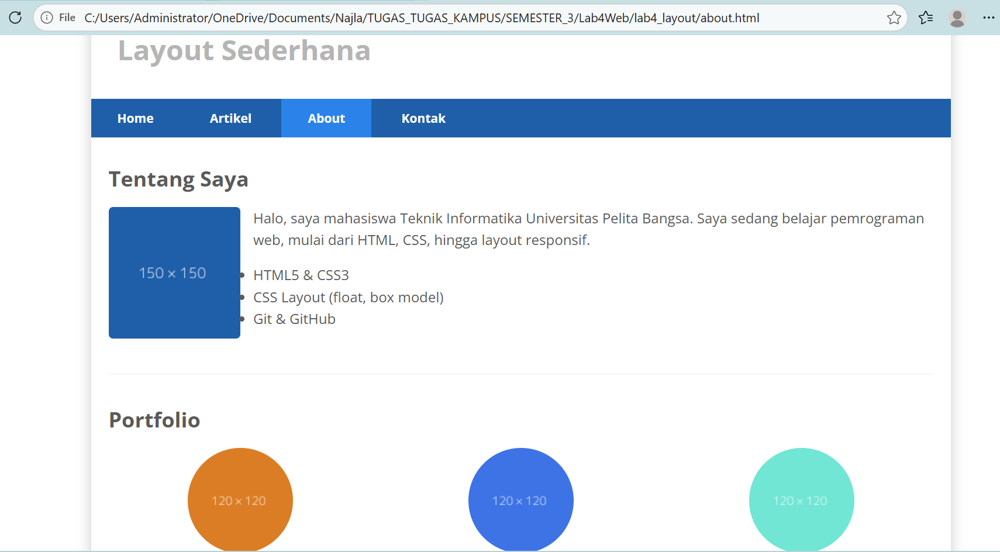

### Tugas 2: Halaman Kontak

File `kontak.html` berisi formulir dengan isian nama, email, subjek, dan pesan, serta tombol "Kirim Pesan". Setiap isian dibungkus `.form-group` dan diberi label agar jelas. Isian nama, email, dan pesan memakai atribut `required` supaya tidak bisa dikirim dalam keadaan kosong. Formulir ini hanya berupa tampilan, sehingga belum terhubung ke proses pengiriman data.

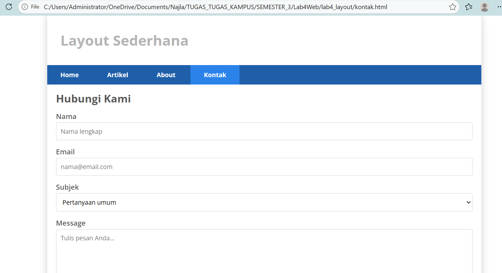

---

## Bagian 5. Validasi HTML

Validasi dilakukan melalui https://validator.w3.org dengan metode upload file.

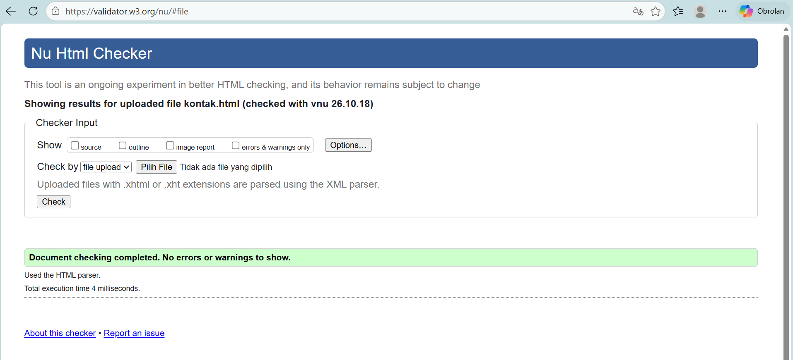

Pada awal pengecekan muncul satu peringatan (*warning*), bukan error, yaitu "Section lacks heading". Peringatan ini muncul karena `<section id="wrapper">` tidak memiliki judul (`h1` sampai `h6`). Karena `wrapper` hanya berfungsi sebagai pembungkus layout, elemen tersebut diganti menjadi `<div id="wrapper">`. Perubahan ini tidak memengaruhi tampilan karena CSS memakai selector `#wrapper`.

---

## Kesimpulan

1. Elemen HTML pada dasarnya berbentuk kotak (box) yang terdiri dari margin, border, padding, dan content.
2. Properti `float` membuat elemen tersusun berdampingan, sedangkan `clear` mengatur posisi elemen setelah elemen float.
3. Elemen yang seluruh isinya float membuat tinggi induknya menjadi nol, sehingga diperlukan clearfix.
4. Elemen semantik seperti `header`, `nav`, `section`, `aside`, dan `footer` membuat struktur halaman lebih jelas dibandingkan memakai `div` saja.
5. Layout dua kolom dapat dibuat dengan menjumlahkan lebar, padding, dan border dengan teliti agar totalnya sesuai lebar container.